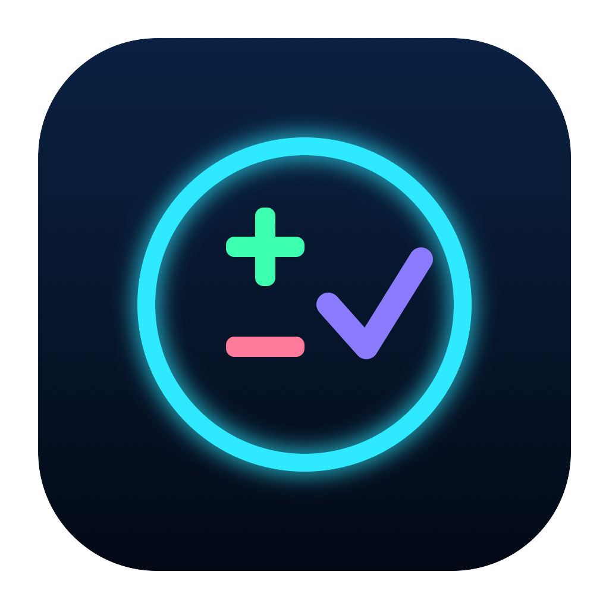
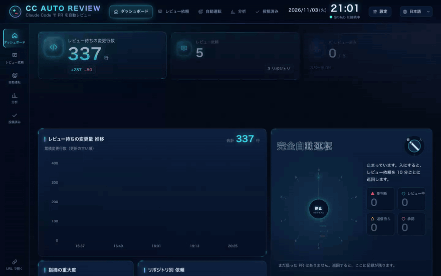

> [!TIP]
> **⭐ `focus-cafe` のアーリーアクセスを受け取るには、このリポジトリにスターを付けて X で [@kara_mage](https://x.com/kara_mage) をフォローしてください**。

> [!NOTE]
> このプロジェクトは Anthropic との提携関係になく、Anthropic による承認や後援も受けていません。Claude は Anthropic, PBC の商標です。このプロジェクトは Claude を利用した個人開発者による独立したプロジェクトです。

<div align="center">
  

  <h1>CC Auto Review</h1>

  <p>
    <strong>手元の Claude Code で GitHub の Pull Request をレビューする</strong>
  </p>
  <p>
    <code>claude -p</code> を使う macOS と Linux のデスクトップアプリです。diff の横に AI の指摘を並べ、変更のリスクを 0〜100 点で示し、完全自動運転ではリスクのある PR だけを人に回します。
  </p>

  <p>
    <a href="#-機能"></a>
    <a href="#-インストール"></a>
    <a href="#-使い方"></a>
    <a href="#-開発"></a>
  </p>
  <p>
    <a href="https://github.com/karamage/cc-auto-review/actions/workflows/ci.yml"></a>
    
    
    
    
    <a href="LICENSE"></a>
  </p>

  <p><a href="https://karamage.github.io/cc-auto-review/ja/#download"><strong>macOS 版をダウンロード</strong></a> · <a href="https://karamage.github.io/cc-auto-review/ja/#risk"><strong>PR をブラウザで採点する</strong></a> · <a href="https://karamage.github.io/cc-auto-review/ja/">サイト</a></p>

  <p><a href="README.md">English README</a></p>
</div>

<p align="center">
  <a href="https://karamage.github.io/cc-auto-review/ja/"></a>
</p>

<p align="center">
  
  <br>
  <sub>PR を開いて AI レビューを実行し、指摘に移動して採用する（サンプルデータ）</sub>
</p>

> [!TIP]
> CC Auto Review は Claude の認証情報を保存しません。手元にインストールした未改変の Claude Code を、あなたの設定のまま実行します。GitHub へのアクセスは `gh` のログインを使います。利用には [Anthropic の規約](https://code.claude.com/docs/en/legal-and-compliance)が適用されます。完全自動運転を使う前に規約を確認するか、API キーを使ってください。

> [!NOTE]
> このプロジェクトは Anthropic とは関係がなく、Anthropic の承認や支援も受けていません。Claude は Anthropic, PBC の商標です。アプリが投稿するレビューは**あなたの** GitHub アカウントから出ます。

## 🌟 概要

**CC Auto Review** は、Pull Request の diff と Claude の指摘を 1 画面に並べます。指摘を 1 件ずつ採用・却下・編集し、GitHub にレビューを投稿します。レビューはローカルにインストールした Claude Code（`claude -p`）が行います。作業場所は、PR の変更ファイルだけを置いた一時ディレクトリです。

**完全自動運転**をオンにすると、レビュー依頼をアプリが自分で処理します。承認かコメントをして作成者の対応を待ち、再レビューします。CI・マイグレーション・認証・秘密情報・巨大な変更・リスクの点数が高い PR は、投稿せずに人へ回します。

## 📋 目次

- [🌟 概要](#-概要)
- [✨ 機能](#-機能)
- [🚀 インストール](#-インストール)
- [📖 使い方](#-使い方)
  - [指摘の重大度](#指摘の重大度)
  - [変更のリスクの点数](#変更のリスクの点数)
- [⚙️ レビューのカスタマイズ](#️-レビューのカスタマイズ)
  - [レビュープロファイル](#レビュープロファイル)
  - [完全自動運転](#完全自動運転)
- [🏗 仕組み](#-仕組み)
- [🔒 セキュリティ](#-セキュリティ)
- [🛠 開発](#-開発)
- [🤝 コントリビュート](#-コントリビュート)
- [📄 ライセンス](#-ライセンス)
- [🙏 謝辞](#-謝辞)

## ✨ 機能

### 🔍 1 画面で AI レビュー
- **diff と指摘を並べて表示**: 指摘は diff の行に付き、サイドパネルにも一覧で出ます。クリックするとその行に移動します。
- **最後に決めるのは人**: 投稿の前に、すべての指摘を採用・却下・編集できます。
- **レビュー後に質問**: 指摘の確認やコードの説明を AI に頼み、相談で見つかった問題を下書きの指摘に追加できます。
- **確かめられた指摘に絞る**: blocker と should には起きる条件と影響を書かせ、書けなければ question に下げます。
- **過去のコメントを確かめ直す**: 以前のレビューコメントが今のコードで直っているかを「修正済み / 未修正 / 確認できず」で示します。
- **好きな言語で投稿**: 指摘と違う言語で投稿するときは、投稿の直前に訳します。

### 📦 clone しない
- **変更ファイルだけ**を一時ディレクトリに取り寄せます。
- **読み取り専用のコマンド**（`remote-read`）: 呼び出し元・型・テストは、PR のリポジトリとコミットに固定した GET リクエストで Claude が GitHub から読みます。

### 🎯 変更のリスクの点数
- **機械的な基準点**: diff だけから、規模・広がり・影響の大きい領域・危ないパターン・テストの不足・変更の形・経緯を足します。
- **AI の補正は ±20 点まで**: 項目ごとに `file:line` を引用させます。計算はサーバが行います。
- **エスカレーション**: 重大な問題を確かめたら、その PR を人に回します。

### 🧩 レビュープロファイル
- **観点・チームの指示・指摘しないこと・指摘数の上限・追加のツール**（Skill、MCP）をプロファイルごとに決められます。
- **同梱のプロファイル**: *Standard*、*Security focused*、*Quick (blockers only)*。
- **プロンプトの確認**: Claude に渡るプロンプトをそのまま見られます。
- **リポジトリの規約**（`CLAUDE.md`・`AGENTS.md`・`REVIEW.md`）は base ブランチのものを読みます。

### 🤖 完全自動運転（任意）
- **レビュー依頼を定期的に巡回**し、承認かコメントをして、作成者が push か返信をしたら再レビューします。
- **リスクのある PR は人へ**: パス、変更行数、リスクの点数、自然言語で書いた基準のどれかに当たれば人に回します。
- **プロファイルの振り分け**: リポジトリ、ラベル、メンション（`@org/security` など）で使うプロファイルを変えられます。

<p align="center">
  
  <br>
  <sub>完全自動運転をオンにすると、5 件の PR をレビューして承認かコメントをし、危ない 1 件だけを人に回す（サンプルデータ）</sub>
</p>

### 🖥 macOS のネイティブアプリ
- **小さい**: CPU ごとの版は約 12 MB、universal 版は約 23 MB です。サーバは約 6 MB の JavaScript ランタイム [txiki.js](https://github.com/saghul/txiki.js) で動きます。
- **デスクトップ通知**: AI レビューが終わったときと失敗したときに知らせます。
- **日本語と英語**の画面に対応しています。

## 🚀 インストール

### ダウンロード

Apple シリコン版か Intel 版の **[DMG をダウンロード](https://karamage.github.io/cc-auto-review/ja/#download)** して開き、アプリを「アプリケーション」にドラッグしてください。Developer ID で署名し、Apple の公証を受けているので、そのまま開けます。過去の版は[リリースページ](https://github.com/karamage/cc-auto-review/releases)にあります。

Linux（x86_64）では、[リリースページ](https://github.com/karamage/cc-auto-review/releases)から `.AppImage` か `.deb` をダウンロードしてください。署名はしていないので、各ファイルと一緒に置く `.sha256` で確かめてください。

### 必要なもの

- macOS 11 以降、または WebKitGTK 4.1 のある Linux x86_64
- [GitHub CLI](https://cli.github.com)（`gh`）。`gh auth login` 済みであること
- [Claude Code](https://claude.com/claude-code)（`claude`）2.1.314 以降

`gh` と `claude` はログインシェルの `PATH` から探すので、Finder や Dock から起動しても動きます。

<details>
<summary><strong>ソースからビルドする</strong></summary>

```bash
git clone https://github.com/karamage/cc-auto-review.git
cd cc-auto-review
bun install
bun run app:build
```

できた `CC Auto Review.app`（`src-tauri/target/release/bundle/macos/`）を `/Applications` に入れてください。

| コマンド | できるもの |
| --- | --- |
| `bun run app:build` | ビルドしたマシンの CPU 向けの `.app`（約 12 MB） |
| `bun run app:build:x64` | Intel Mac 向けの `.app`（Apple Silicon の Mac からも作れる） |
| `bun run app:build:universal` | Apple Silicon と Intel の両方で動く 1 つの `.app`（約 23 MB） |
| `bun run app:dmg`（`:x64`、`:universal`） | 同じものを `.dmg` で |

> [!IMPORTANT]
> 手元でビルドしたアプリは署名されていません。開けないときは「システム設定 → プライバシーとセキュリティ → このまま開く」で許可してください。`bun run release:mac` で作った DMG は署名・公証済みなので、そのまま開けます。

Linux では `cmake`、C コンパイラ、[Tauri が要るシステムパッケージ](https://tauri.app/start/prerequisites/#linux)を入れて、`bun run app:build:linux` を実行します。初回は txiki.js をソースからビルドします。リリース用の Linux パッケージは、リリースを公開すると `.github/workflows/release-linux.yml` が作ります。

</details>

## 📖 使い方

```
ダッシュボード → PR を開く → プロファイルとモデルを選ぶ → AI レビューを実行 → 採用・却下・編集 → 投稿
```

1. **ダッシュボード**: レビューを依頼されている PR が出ます（github.com/pulls/review-requested と同じ条件）。URL を貼れば任意の PR も開けます。
2. **AI レビューを実行**: PR を開き、**レビュープロファイル**と**モデル**を選び、必要なら重点的に見てほしいことを書いて **AI レビューを実行** を押します。
3. **指摘を仕分ける**: 指摘ごとに採用・却下・編集します。diff の外を指す指摘はレビュー本文にまとめます。
4. **投稿**: 「コメント / 承認 / 修正を求める」を選んで投稿します。指摘を書いた言語と違う言語で投稿するときは、投稿の直前に Claude が訳します。
5. **見守り（任意）**: **見守りを始める** を押すと、作成者が push か返信をしたときに AI レビューをやり直します。再投稿は人が確かめてからです。

### 指摘の重大度

| 重大度 | 意味 |
| --- | --- |
| blocker | マージ前に必ず直す、確かめられた不具合 |
| should | 直すべきだが、後回しにしても安全なもの |
| question | 意図が分からず結論を出せないもの。何が分かれば判断できるかを書く |
| nit | 好みの範囲の改善案（既定では非表示） |

blocker と should には、起きる条件（trigger）と影響（impact）を必ず書かせ、書けなければ question に下げます。PR に過去のレビューコメントがあれば、指摘ごとに今のコードで直っているかを判定します（修正済み / 未修正 / 確認できず）。作成者の「直しました」や解決済みのスレッドは根拠にしません。

### 変更のリスクの点数

レビュー画面の左側に、PR の変更リスクを 0〜100 の点数で出します（採点モデルは [pr-risk-score](https://github.com/karamage/pr-risk-score) を移植したもの）。

- **基準点**: PR を開いた時点で、diff だけから機械的に決めます。変更の規模と広がり、影響の大きい領域（認証・決済・マイグレーション・CI など）、追加行の危ないパターン（秘密情報、eval、XSS、破壊的な SQL など）、テストの不足、変更の形、PR の経緯の 7 つの要因を足します。秘密情報の混入（90 点）、破壊的なマイグレーション（75 点）、AI を操ろうとする文（60 点）などには下限があります。
- **AI の補正**: AI レビューを実行すると、Claude が diff の意味を読み、`file:line` を引用した項目で ±20 点まで補正します。認可の迂回や取り返しのつかないデータ消失のような重大な仕組みを確かめた場合は「エスカレーション」として 60 点以上にし、人に回します。点の計算はサーバが行い、AI には上限・下限を動かさせません。

| 点数 | 段階 |
| --- | --- |
| 0–24 | LOW |
| 25–50 | MEDIUM |
| 51–75 | HIGH |
| 76–100 | CRITICAL |

完全自動運転は、点数が閾値（既定 50）を**超えた** PR とエスカレーションのある PR を、投稿せずに人へ回します。

## ⚙️ レビューのカスタマイズ

ダッシュボード右上の **設定** を開きます。

### レビュープロファイル

プロファイルは「どうレビューするか」の一式です。*Standard*、*Security focused*、*Quick (blockers only)* を同梱しています。書き換えても、新しく作っても構いません。

| 項目 | 内容 |
| --- | --- |
| レビューの観点 | レビュアーが見るのはこれだけです。オン・オフ、並べ替え、書き換え、追加（「アクセシビリティ」「自社の API バージョニング規約」など）ができます。どの言語で書いても構いません |
| チームのレビュー指示 | 自由記述。規約、重視すること、口調、「修正案は suggestion ブロックで」など |
| 指摘しないこと | 1 行に 1 つ。ノイズになる指摘を止めます |
| 指摘の数の上限 | 重いものから N 件だけ残させます |
| 追加で許すツール | `Skill`、`WebFetch`、`mcp__docs` など。既定では読み取りのツールしか許しません。**書き込みのできるツールは許さないでください**（PR の本文に紛れた指示で呼ばれうるため） |

**プロンプトを確認** で、Claude に渡るプロンプトをそのまま見られます。

リポジトリの `CLAUDE.md`・`AGENTS.md`・`REVIEW.md` も読ませます。どれも **base ブランチの内容**を使うので、PR が自分をレビューする規約を書き換えることはできません。`.claude/`・`.mcp.json`・`CLAUDE.local.md` は作業ディレクトリに置きません。

### 完全自動運転

| 設定 | 既定値 |
| --- | --- |
| モデル / プロファイル | Haiku / Standard |
| 巡回の間隔 | 10 分 |
| 人に回すまでのコメント回数 | 3 |
| 指摘が無ければ承認する | オン（オフにすると、指摘が無い旨をコメントするだけで承認は人に任せる） |
| 承認に LGTM 画像を添える | オフ |
| 自動判断に任せるラベル | `auto-judge` |
| AI レビューを見送るラベル | `skip-ai-review` |
| プロファイルの振り分け | リポジトリ、ラベル、メンション（`@org/security` など）に当たった PR を別のプロファイルでレビュー |
| 人に任せる基準 | AI がリスクを判定するときに読む、自然言語の基準（認証・課金、マイグレーション、CI・インフラ、API の互換性など）。追加・編集のほか、「ドキュメントだけの変更は人に回さなくてよい」のように緩めることもできる |
| AI を呼ばずに人へ回すパス | CI、DB マイグレーション、インフラ、秘密情報、認証・課金・暗号、レビュー規約（正規表現で編集可） |
| 人に回す変更行数 | 1000（ロックファイルと `dist/` は数えない） |
| 人に回すリスクの点数 | 50（これを超えたら人に回す） |

完全自動運転はアプリを開いている間だけ動きます。投稿は**あなたの** GitHub アカウントから行われ、本文に自動レビューであることを書きます。完全自動運転は Claude Code を自動で実行するので、オンにする前に [Anthropic の規約](https://code.claude.com/docs/en/legal-and-compliance)を確認するか、API キーを使ってください。

### 保存先

設定とアプリの状態は `~/.config/cc-auto-review/` に保存します（環境変数 `CC_AUTO_REVIEW_HOME` で変えられます）。

## 🏗 仕組み

```
CC Auto Review.app
├── Tauri の殻（Rust）          サーバを起動し、ウィンドウで開く
├── cc-auto-review-server       txiki.js（約 6 MB の JS ランタイム）。server.js を動かす
└── Resources/server.js         Hono のサーバを 1 つの JS にまとめたもの
    ├── 127.0.0.1 で画面と API を配る（ポートは毎回空いているもの、起動ごとの合言葉付き）
    ├── gh  → PR 一覧、diff、コメント、レビューの投稿
    └── claude -p  → レビュー。変更ファイルだけを置いた一時ディレクトリで動く
            └── remote-read（cat / cat-base / ls / find / grep / issue）→ GitHub。GET のみ
```

- 投稿の直前に PR の head を確かめ直し、レビュー後に更新されていれば投稿しません。
- AI レビューは 10 分でタイムアウトします（設定で変更可）。

## 🔒 セキュリティ

1. **ローカルだけで待ち受ける**: サーバは `127.0.0.1` で待ち受けます。デスクトップアプリでは、起動時に作った合言葉を持つリクエストしか API が受け付けないので、ほかのアプリやブラウザのページからは操作できません。
2. **ファイルへのアクセスを限定**: Claude が読めるのは、PR の変更ファイルと diff を置いた一時ディレクトリの中だけで、書けるのは結果のファイルだけです。ほかに使えるのは `Grep`・`Glob` と `remote-read` です。`git`、任意の `gh`、その他のシェルコマンドは、既定の権限モードによらず拒否します。Claude Code の設定に自分で書いた allow ルールとプロファイルの追加ツールは有効なままなので、範囲を絞ってください。PR の文面でレビューの内容そのものを誘導される可能性は残るので、投稿内容は確認してください。
3. **Claude からの GitHub アクセスは GET だけ**: `remote-read` は読む先のリポジトリとコミットを環境変数で固定し、書き込みのリクエストは出しません。
4. **PR は規約を書き換えられない**: 規約は base ブランチのものを読み、PR の `.claude/`・`.mcp.json`・`CLAUDE.local.md` は作業ディレクトリに置きません。
5. **テレメトリなし**: 利用状況のデータは送りません。通信するのは `gh` 経由の GitHub と `claude` 経由の Claude で、画面がほかに Web フォントと（オンのときは）LGTM 画像を読み込みます。

## 🛠 開発

### 技術スタック

- **デスクトップの殻**: [Tauri 2](https://tauri.app)（Rust）
- **サーバ**: [Hono](https://hono.dev)。アプリでは 1 つの JS にまとめて [txiki.js](https://github.com/saghul/txiki.js) で、開発時は [Bun](https://bun.sh) で動かす
- **画面**: React 19 + TypeScript + Vite
- **ツール**: Bun（パッケージ管理とテスト）、Biome、oxlint

### ディレクトリ構成

```
cc-auto-review/
├── src/
│   ├── client/        # React の画面（ページ、コンポーネント、完全自動運転の状態）
│   ├── server/        # Hono の API、gh / claude の実行、diff の解析、作業ディレクトリ
│   │   ├── reviewer/  # プロンプトの組み立て、claude -p の実行、remote-read、翻訳
│   │   └── runtime/   # Bun と txiki.js の差を吸収する層
│   └── shared/        # 画面とサーバで共有する型、設定、リスクの点数
├── src-tauri/         # 同梱のサーバを起動する Tauri の殻
└── scripts/           # サーバのバンドルと、署名付きリリースのビルド
```

### コマンド

必要なもの: [Bun](https://bun.sh)、Rust（`rust-toolchain.toml` で `stable` を指定）、Xcode Command Line Tools

```bash
bun install
bun run check        # 型検査 + lint + format の確認 + テスト
bun run app:build    # 画面・サーバの実行ファイル・CC Auto Review.app をビルド
bun run app:dmg      # .dmg も作る（Finder の自動操作の許可が要ることがある）
bun run app:build:x64         # Intel Mac 向けの .app（Apple Silicon の Mac からも作れる）
bun run app:dmg:x64           # 同じものを .dmg で
bun run app:build:universal   # Apple Silicon と Intel の両方で動く 1 つの .app
bun run app:dmg:universal     # 同じものを .dmg で
```

ブラウザだけで開発する場合（Tauri なし）:

```bash
bun run dev:server   # API（localhost:4711）
bun run dev:client   # Vite（localhost:5173。/api は 4711 にプロキシ）
```

テストは実際の `gh` / `claude` / `git` を起動せず、`CommandRunner` の偽実装を使います。

<details>
<summary><strong>署名・公証した DMG を作る</strong></summary>

最初に一度だけ準備します（Apple Developer Program への加入が必要です）。

1. 「Developer ID Application」の証明書を作る: Xcode → Settings → Accounts → Manage Certificates → `+`
2. 公証の認証情報をキーチェーンに保存する（パスワードには [App 用パスワード](https://support.apple.com/ja-jp/102654)を使う）

   ```bash
   xcrun notarytool store-credentials cc-auto-review --apple-id <Apple ID> --team-id <Team ID>
   ```

あとは次のコマンドで作れます。

```bash
bun run release:mac             # → release/CC-Auto-Review_<version>_arm64.dmg と _x64.dmg
bun run release:mac arm64       # Apple Silicon 版だけ
bun run release:mac universal   # 両方で動く 1 つの DMG
```

既定では Apple Silicon 版と Intel 版を別々に作ります。CPU ごとにアプリをビルドし、Hardened Runtime 付きで署名します。続けてアプリを公証してチケットを貼り、DMG にまとめ、DMG も公証してチケットを貼ります。証明書を選ぶときは `APPLE_SIGNING_IDENTITY`、別のプロファイルを使うときは `NOTARY_PROFILE` を指定します。

</details>

## 🤝 コントリビュート

Issue と Pull Request を歓迎します。PR を出す前に `bun run check` を通してください。

特に助かること:

- 🐛 不具合の報告と修正
- 🧭 既定のレビュー観点・プロファイルの追加
- 🌐 日本語と英語以外への画面の翻訳
- 🪟 Windows への対応
- 📚 ドキュメントとスクリーンショット

## 📄 ライセンス

MIT License です。詳しくは [LICENSE](LICENSE) を見てください。

## 🙏 謝辞

- レビューを担う Anthropic の [Claude Code](https://claude.com/claude-code)
- 小さなネイティブアプリを可能にしている [Tauri](https://tauri.app)、[txiki.js](https://github.com/saghul/txiki.js)、[Hono](https://hono.dev)
- [GitHub CLI](https://cli.github.com)
- LGTM 画像の [LGTMoon](https://lgtmoon.dev)
- README の構成の参考にした [opcode](https://github.com/winfunc/opcode)

---

<div align="center">
  <a href="https://github.com/karamage/cc-auto-review/issues">不具合を報告</a>
  ·
  <a href="https://github.com/karamage/cc-auto-review/issues">機能を提案</a>
</div>
